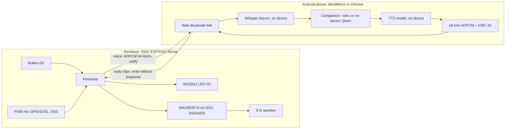
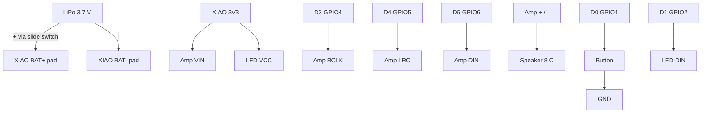
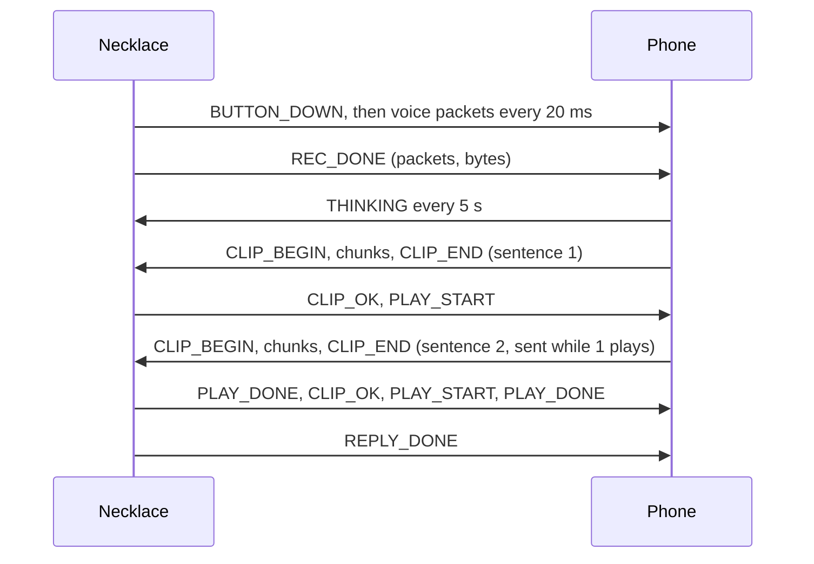

# MindMirror AI Necklace: build guide (v2, speaks through its own speaker)

The student presses a button on the necklace, speaks, lets go, and hears the reply from the necklace's own speaker. The phone does the listening, thinking and voice-making, all on the device.

Labels used below: **[Verified]** means checked against a manufacturer page or by compiling and testing the code here. **[Estimate]** is an engineering estimate. **[Assumption]** is something we could not check and you should confirm.

## What to do now

1. Order the parts in section 3 today.
2. Answer two questions in the thread: do you have a soldering iron, and which Android phone will you use?
3. While the parts ship, open MindMirror on the demo phone over Wi-Fi, go to the Necklace room, tap **No necklace? Try with your phone mic**, and talk once. That downloads the speech and voice models (about 80 MB) so the venue Wi-Fi doesn't matter.
4. When the parts arrive, follow section 15. Test the speaker in hour 2, not at the end.

## 1. Feasibility

**Verdict: feasible in 24 hours with the Seeed XIAO ESP32S3 Sense, a MAX98357A I2S amplifier and a small 8 Ω speaker.** The firmware in this repo compiles for this board **[Verified: Arduino core 3.3.12, NimBLE-Arduino 2.5.1, 745 KB = 22% of flash]**. The app side is built and its transfer logic is unit tested **[Verified: 31 tests]**. Nothing has been tested on real hardware yet, because there is no hardware yet.

**Budget.** ₹2,000 is not realistic when buying everything on Amazon.in. The XIAO ESP32S3 Sense alone takes most of it. I couldn't open Amazon's product pages to read prices, so treat **₹2,700 to ₹3,500 without a soldering kit** as an **[Estimate]** and check at checkout. The cheapest fix is the board: Robu.in or the Seeed store are usually cheaper than Amazon resellers **[Assumption]**.

**The three compromises:**

- **Half duplex.** The necklace either listens or talks, never both, so there is no echo or feedback to cancel. Pressing the button while it talks interrupts it.
- **The phone screen stays on during a session.** A web page in Chrome can't keep Bluetooth running with the phone locked. The app holds a screen wake lock while the necklace is paired. Using it with the phone locked in a pocket needs the native Android app (section 17).
- **A short wait before the reply.** The phone transcribes, thinks and makes the voice before the necklace speaks. The first sentence plays while the next one is still being made. Expect roughly 2 to 6 seconds on a mid-range Android phone **[Estimate]**.

## 2. System architecture



One primary transport, Bluetooth Low Energy, both ways. Wi-Fi was rejected for v1. The web app is served over HTTPS, and Chrome blocks HTTPS pages from calling a plain-HTTP device on the local network (mixed content). Wi-Fi would also need a hotspot setup step and draws more power. BLE is enough: replies are 8 KB per second of speech, and one sentence (about 24 KB) takes around a second to send **[Estimate]**.

## 3. Bill of materials (Amazon.in)

| # | Part | Link | Why this one |
|---|---|---|---|
| 1 | Seeed XIAO ESP32S3 **Sense** | [Amazon](https://www.amazon.in/Seeed-Studio-XIAO-ESP32S3-Sense/dp/B0C69FFVHH) | Built-in mic, LiPo charger, 8 MB PSRAM, BLE 5. Must say *Sense*. |
| 2 | MAX98357A I2S amp (buy 2) | [SmartElex](https://www.amazon.in/SmartElex-MAX98357A-Amplifier-Raspberry-Microcontrollers/dp/B0G2LCY1DK) | Digital in, speaker out, no DAC needed. |
| 3 | Speaker, 8 Ω, 1 W or more | [ACEIRMC 3W 8Ω, enclosed](https://www.amazon.in/ACEIRMC-Loundspeaker-JST-PH2-0-Interface-Electronic/dp/B0BTM1VCBM), or smaller [uxcell 28 mm 1W](https://www.amazon.in/uxcell-Magnet-Loudspeaker-Player-Speaker/dp/B019JMV0JY) | A speaker in its own small box is much louder for voice. |
| 4 | LiPo 3.7 V 500 mAh | [Lipix 552030](https://www.amazon.in/Lipix-552030-Rechargeable-Battery-500mAh/dp/B0FT3QN7PJ) | Fits behind the board. It needs a protection circuit **[Assumption: check the listing]**. |
| 5 | 6×6 mm push buttons | [pack](https://www.amazon.in/SOOTRA-Tactile-Button-Electrical-Projects/dp/B0BJ73FWS7) | Talk button. |
| 6 | SS12D00 slide switch | [pack](https://www.amazon.in/20PCS-CAMAY-SWITCH-SS-12D00-2-54mm/dp/B0BKLB3S7D) | Power off. |
| 7 | WS2812 RGB LED breakout | [REES52](https://www.amazon.in/REES52%C2%AE-CJMCU-123-Breakout-Display-ardiuno/dp/B08PBX8TLT) | Status colours. |
| 8 | 26 AWG silicone wire | [kit](https://www.amazon.in/BNTECHGO-Silicone-Flexible-Stranded-Tinned/dp/B09X4629C1) | Soft, survives bending. |
| 9 | Soldering kit, if you have none | [60 W adjustable](https://www.amazon.in/Soldering-Iron-Wire-Stand-Professional/dp/B0HCVC232Z) | The XIAO ships without pins attached **[Verified: Seeed wiki]**. |
| | Also useful | heat-shrink tube, double-sided foam tape, hot glue, a multimeter | |

Prices: not shown, because I couldn't read them. Don't trust any total until you see the cart.

## 4. Verified hardware compatibility

| Question | Answer | Source |
|---|---|---|
| Does the Sense have a mic? | Yes, a PDM mic. Clock on GPIO42, data on GPIO41. | [Verified] Seeed wiki, Sense mic page |
| Can it drive a speaker by itself? | No. It needs an amplifier. Never wire a speaker to a GPIO pin. | [Verified] |
| Can the mic and the amp run together? | Yes. The ESP32-S3 has two I2S controllers. The firmware puts the PDM mic on I2S0 and the amp on I2S1, with fixed port numbers. | [Verified] the firmware compiles; ESP32-S3 has I2S0 and I2S1 |
| Pin conflicts? | None. D8 to D10 and GPIO21 belong to the SD card, and the camera uses the board-to-board connector. We use D0 to D5 only. | [Verified] Seeed pin multiplexing page |
| Amp supply range | 2.5 to 5.5 V. | [Verified] Adafruit MAX98357 guide |
| Amp power at 3.3 V into 8 Ω | 0.8 W at 10% distortion, 0.6 W at 1%. | [Verified] Adafruit guide |
| 3V3 pin current | Up to 700 mA. | [Verified] Seeed wiki |
| 5V pin on battery | No voltage on battery power. | [Verified] Seeed wiki |
| LiPo charging on board | Yes, through the USB-C port. 50 mA charge current is listed for the XIAO ESP32S3; the Sense row gives no figure. | [Verified] Seeed wiki |
| Bluetooth Classic or headset mode | No. The ESP32-S3 is BLE only, so this is a custom BLE protocol, not a Bluetooth speaker. | [Verified] |

## 5. Wiring and pin assignments

| From | To | Note |
|---|---|---|
| MAX98357A VIN | XIAO **3V3** | works the same on USB and on battery (see section 7) |
| MAX98357A GND | XIAO GND | |
| MAX98357A BCLK | **D3** (GPIO4) | |
| MAX98357A LRC | **D4** (GPIO5) | |
| MAX98357A DIN | **D5** (GPIO6) | |
| MAX98357A GAIN, SD | leave unconnected | 9 dB gain, left+right mix (default) |
| Speaker + and − | amp + and − | polarity doesn't matter for one speaker |
| Button, one leg | **D0** (GPIO1) | |
| Button, other leg | GND | internal pull-up, no resistor |
| WS2812 DIN | **D1** (GPIO2) | |
| WS2812 VCC and GND | 3V3 and GND | WS2812 is rated from 3.5 V; one LED usually works at 3.3 V **[Assumption]** |
| LiPo + | slide switch, then XIAO **BAT+** pad | pads are under the board |
| LiPo − | XIAO **BAT−** pad | Seeed: negative is the pad nearer the USB port. Check the silkscreen. |
| Optional battery sense | BAT+ (after switch) to 100 kΩ to **D2**, then 100 kΩ to GND | then set `BATTERY_SENSE 1` in `config.h` |
| Antenna | U.FL connector | clip in the antenna that comes in the box |



Keep the I2S wires (D3, D4, D5) under 10 cm and twisted with a ground wire if you can **[Estimate]**.

## 6. Speaker and amplifier

- **Amplifier:** MAX98357A. It takes the digital I2S signal straight from the ESP32-S3 and drives the speaker. There's no separate DAC, no analog wiring and no volume knob; volume is set in software from the app (saved on the necklace).
- **Speaker:** 8 Ω, rated 1 W or more. The amp can't deliver more than 0.8 W at 3.3 V **[Verified]**, so a 1 W speaker is never overdriven. A 4 Ω speaker would also work but draws twice the current, so stay with 8 Ω.
- **Size:** about 28 mm round, or a small enclosed box speaker. The enclosed type sounds much fuller for speech **[Estimate]**.
- **Loudness:** clearly audible to the wearer and someone next to them in a quiet room **[Estimate]**. Not intelligible in a noisy hall, and we make no such claim. For judges, hold the necklace up near them, or turn volume to 90 to 100.
- **Clarity:** replies are 16 kHz audio, which carries speech up to 8 kHz. That's above what a 28 mm speaker reproduces well, so the speaker is the limit, not the audio format **[Estimate]**.
- **Power:** see section 7.

## 7. Battery and power budget

**Architecture.** LiPo, then slide switch, then the XIAO's BAT pads. The XIAO's charger fills the cell from USB-C, and its regulator makes 3.3 V for the chip, the amp and the LED. The amp runs from 3V3 instead of the raw battery so the same wiring works on USB alone and on battery. The 5V pin is dead on battery **[Verified]**, so it can't be used.

Is 3V3 enough for the amp? The regulator is rated 700 mA **[Verified]**. The amp at 3.3 V into 8 Ω peaks around 0.8 W, roughly 300 to 350 mA from the rail **[Estimate]**, and the firmware's volume curve keeps speech well below that. ESP32-S3 plus BLE is about 100 mA **[Verified: Seeed lists 102 mA BLE active for the Sense]**. That leaves headroom. If the necklace ever resets during a loud reply (a brownout), lower the volume or move the amp's VIN to BAT+ after the switch (the amp accepts up to 5.5 V **[Verified]**).

| State | Current from battery | Source |
|---|---|---|
| Connected, idle | 45 to 100 mA | [Estimate] from Seeed's Sense figures (44 mA modem sleep, 102 mA BLE active) |
| Recording (mic + BLE) | about 100 to 120 mA | [Estimate] Seeed lists 64.5 mA average for mic + SD recording on battery, plus BLE |
| Speaking at volume 70 | 150 to 250 mA average, peaks to about 400 mA | [Estimate] |
| LED | 1 to 10 mA | [Estimate] |

**Runtime on 500 mAh: about 4 to 5 hours** of a demo day with a few conversations an hour **[Estimate]**. **Charging:** at 50 mA a flat 500 mAh cell takes about 10 to 12 hours **[Estimate from the Seeed figure]**, so charge it the night before and keep a power bank and USB-C cable on the table.

**Safety:** use a cell with a protection board. Check polarity twice before the first connection. Never charge a swollen or punctured cell. Don't charge it while it's being worn, and don't leave it charging unattended. Tape over every bare joint.

## 8. Bluetooth protocol

The full spec, with UUIDs, every op and event, example bytes and timeouts, is in [`docs/NECKLACE_PROTOCOL.md`](https://github.com/pankqx/checking/blob/main/docs/NECKLACE_PROTOCOL.md). The firmware (`protocol.h`) and the app (`src/lib/necklace/protocol.ts`) use exactly those values.

In short:

- **Uplink (voice):** while the button is held, the necklace sends one 160-byte ADPCM packet every 20 ms, numbered, with a session id. On release it sends REC_DONE with the packet count, so the app knows nothing went missing.
- **Downlink (reply):** each sentence is one clip. The app sends BEGIN (size, sample count, CRC-32, chunk size), the chunks, then END. The necklace checks every chunk arrived and the CRC matches. Only then does it say CLIP_OK and play. If something is missing it names the first missing chunk and the app resends from there.
- **MTU:** the necklace asks the phone for a 517-byte MTU itself, reports the result, and both sides size packets from it.



## 9. Audio format and encoding

| | Choice | Why |
|---|---|---|
| Format | IMA ADPCM, 4-bit | 4:1 over PCM, a few dozen lines of code on both sides, no library. Opus would halve the size again but needs a codec library on the ESP32 and a WebCodecs path on the phone; not worth the risk in 24 hours. Raw PCM (256 kbit/s) is too heavy for BLE. |
| Rate, channels | 16 kHz mono | What Whisper wants, and enough for speech. |
| Frame | 20 ms, 320 samples, 160 bytes | One notification per frame. |
| Max recording | 30 s | Firmware stops by itself. |
| Max reply clip | 30 s per sentence-clip (240 KB in PSRAM, 4 clips queued) | Replies are split by sentence, so this limit is never reached in practice. |
| Integrity | CRC-32 per clip | Corrupt audio is never played. |

**How the reply becomes audio data, not phone speaker sound.** Chrome's built-in `speechSynthesis` only plays through the phone and never hands over the audio, so the app doesn't use it for the necklace. Instead it runs a text-to-speech model on the phone with Transformers.js, which returns the raw waveform:

- **Quick voice:** `Xenova/mms-tts-eng`, 38 MB, 16 kHz **[Verified: model files]**. This is the default, and it works on any recent Android phone.
- **Natural voice:** `onnx-community/Supertonic-TTS-ONNX`, 263 MB, 44.1 kHz, voice F1 for Reenu and M1 for Roman **[Verified: model files]**. It uses the phone's GPU through WebGPU when Chrome supports it. Download it on Wi-Fi.

The app resamples to 16 kHz, normalises loudness, encodes ADPCM, and sends it.

## 10. Firmware

Files in [`firmware/mindmirror_necklace/`](https://github.com/pankqx/checking/tree/main/firmware/mindmirror_necklace):

| File | What it holds |
|---|---|
| `mindmirror_necklace.ino` | the whole device: mic, amp, button, LED, BLE, clip queue, playback, fallbacks |
| `config.h` | pins, mic gain, default volume, battery-sense switch |
| `protocol.h` | UUIDs, ops, events, timeouts (mirror of the protocol doc) |
| `adpcm.h`, `crc32.h` | codec and checksum, identical to the app's (checked by `firmware/test/golden.cpp`) |
| `clips.h` | six stored voice lines (generated by `firmware/tools/make_clips.py`) |
| `clip.h` | the reply clip record |

**Flashing (about 15 minutes the first time):**

1. Install Arduino IDE 2.
2. In Boards Manager, install **esp32 by Espressif Systems**, version **3.3.x**.
3. In Library Manager, install **NimBLE-Arduino 2.x**.
4. Open `mindmirror_necklace.ino`. Board: **XIAO_ESP32S3**. **PSRAM: OPI PSRAM** (required). USB CDC On Boot: Enabled.
5. Plug in USB-C and click Upload. If no port appears: hold BOOT, tap RESET, let go of BOOT, then upload again.
6. Open Serial Monitor at 115200. You should see:

```
[necklace] amp ok, mic ok, volume 70, PSRAM 8000+ KB free
[necklace] advertising as MindMirror-XXXX
```

…and hear a two-note chime from the speaker. That chime is your first speaker test.

**Serial messages while you use it:** `connected`, `mtu 517`, `recorded 100 packets, 16000 bytes, 2.0 s`, `clip 3 ok: 20000 bytes, 2.5 s`. If you see `PSRAM missing`, the PSRAM option was off when you uploaded. `clip N missing from chunk M` means the app is about to resend.

**LED colours:** faint teal is connected and idle. A slow warm pulse means not connected. Indigo means listening. Yellow shimmer means the phone is thinking. Soft green means speaking an AI reply. Amber means a stored fallback line. Red flashes mean an error.

## 11. Android integration

**What the app is:** I checked the repo. MindMirror is a React + TypeScript web app (Vite, installable as a PWA). There's no Kotlin, Flutter or React Native code and no backend. Speech-to-text (Whisper), the companion and now text-to-speech all run in the browser.

**Integration service:** `src/lib/pendantStore.ts` with `src/lib/ble.ts` and `src/lib/necklace/`. It reuses the existing Whisper, companion and check-in code and adds:

- discovery and pairing through the Chrome Bluetooth chooser, plus HELLO to read the MTU and features;
- uplink reassembly with gap detection;
- the reply pipeline: sentence split, TTS, resample, ADPCM, CRC, reliable clip transfer with resend;
- keep-alive while thinking, barge-in, automatic reconnect (1, 2, 4, 8, 8 s), a screen wake lock, and error notes in plain words.

**Screen states:** Not paired, Looking for your necklace, Connected, Listening, Got it (uploading), Thinking on your phone, Sending the reply to your necklace (with %), Speaking through your necklace, Done, Reconnecting, Something went wrong.

**The phone speaker is not used** once a necklace with a speaker is paired. If making the voice or sending it fails, the necklace speaks its stored line "I've put my answer on your phone screen", and the text is shown in the app. The phone speaker is used only in simulator mode, where there's no necklace at all.

**Android requirements:** Chrome on Android 6 or later with Bluetooth on. Android asks Chrome for Nearby devices (Android 12+) or Location (older) permission the first time; allow it **[Verified: Android BLE scanning rules]**. Keep MindMirror open with the screen on; the app holds a wake lock. If the screen turns off, Chrome pauses the page and the necklace says "I can't reach your phone" after 30 s.

**Later, for locked-phone use:** wrap the same web app with Capacitor, use the `@capacitor-community/bluetooth-le` plugin in place of Web Bluetooth, Android's `TextToSpeech.synthesizeToFile()` for the voice, and a foreground service so it keeps running in a pocket. The protocol doesn't change.

## 12. Physical assembly

- **Shape:** a pebble about 45 × 35 × 16 mm **[Estimate]**, 3D printed in two halves (PLA or PETG), or a small plastic pill box with holes drilled for a hackathon.
- **Stack, front to back:** speaker facing out at the bottom half of the front, board above it with the mic hole, the button on top of the front, and the battery flat against the back.
- **Openings:** a 1.5 mm mic hole in line with the XIAO Sense mic; a grille of 1.5 mm holes over the speaker; a hole for the LED (or a translucent window); a USB-C slot on the bottom edge; and the slide switch beside it.
- **Acoustics:** keep the mic hole and the speaker grille on opposite ends of the front face. Seal the speaker's back with foam or hot glue so it doesn't "breathe" into the case; voice gets louder. Feedback isn't possible because the mic is off while the speaker plays.
- **Cord:** a loop on top, cotton cord or chain, so the mic sits about 20 cm below the mouth.
- **Mount:** foam tape for the battery and speaker, hot glue for wires at the solder joints, and heat-shrink on every joint.
- **Honest note:** this prototype isn't waterproof and hasn't been tested for long skin contact. Wear it over clothing.

## 13. Failure handling and fallback

| What fails | What the student sees and hears | Recovery |
|---|---|---|
| Bluetooth drops | Necklace: warm pulse. App: Reconnecting. | App retries 5 times over about 23 s; the necklace advertises again at once. A button press meanwhile plays "I can't reach your phone". |
| Voice upload incomplete | Necklace: "Sorry, I didn't catch that." | Student presses again. |
| Reply audio incomplete or corrupt | Nothing garbled is ever played. | Resend from the missing chunk, 2 retries, then the stored line "I've put my answer on your phone screen". |
| Speaker silent | No start-up chime. | Check VIN, GND, BCLK, LRC and DIN, and the speaker wires. Serial shows `amp FAILED` if I2S didn't start. |
| Amp not initialised | Red flashes at boot, serial says `amp FAILED`. | Re-seat wiring, reflash. |
| AI fails | The rule-based companion answers instead; it can't fail. | Automatic. |
| Voice model fails (no internet on first use, low memory) | Necklace: "I've put my answer on your phone screen." | Download the model on Wi-Fi first; switch to the Quick voice. |
| Phone silent for 30 s after you speak | Necklace: "I can't reach your phone right now." | Open MindMirror and keep the screen on. |
| Battery low | Necklace: "My battery is getting low." (when battery sense is wired) | Charge. |
| App in background or screen off | Chrome pauses; same as phone silent. | Keep the screen on (wake lock does this while the app is open). |
| Button pressed while it speaks | Reply stops at once and a new recording starts. | By design. |

**Fallback demo that still uses the necklace speaker:** the **Speaker test** button in the app plays a voice line stored in the necklace. The LED is amber and the line says it's a speaker test, so it's never confused with a live AI reply. **Voice test** makes speech on the phone and sends it, which proves the full downlink without needing the mic or AI.

## 14. Testing checklist

- [ ] Serial shows `amp ok, mic ok` and the chime plays at power-on.
- [ ] Button: LED turns indigo while held.
- [ ] Pair from the app; serial shows `connected` and an MTU of 185 or more.
- [ ] Speaker test plays the stored line, LED amber.
- [ ] Voice test: the necklace says "Hi, I'm Reenu…", LED green.
- [ ] Speak 3 seconds; the app shows what you said correctly.
- [ ] Full turn: the reply plays from the necklace, not the phone.
- [ ] Ten conversations in a row without a reset.
- [ ] Interrupt a reply by pressing the button.
- [ ] Walk 10 m away and back; it reconnects by itself.
- [ ] Switch the phone's Bluetooth off mid-reply; the necklace doesn't play half a sentence.
- [ ] Volume 100 for a minute with no reset (no brownout).
- [ ] Run on battery for 1 hour; note the drop.

## 15. 24-hour schedule

| Hours | Do | Done when |
|---|---|---|
| Before | Download the models on the demo phone (see "What to do now"). Charge the battery overnight. | Simulator mode answers once. |
| 0 to 1 | Unbox. Solder headers or wires to the XIAO and the amp. Clip on the antenna. | No bridges under a magnifier. |
| 1 to 2 | Flash the firmware with only USB connected. | Serial shows `mic ok`. |
| 2 to 3 | **Speaker first:** wire the amp and speaker, reset. | Chime plays. Speaker test from the app plays the stored line. |
| 3 to 4 | Button and LED. | Indigo while held. |
| 4 to 6 | Pair with the Android phone. Speak; check the transcript. | Correct words on screen. |
| 6 to 8 | Voice test, then full conversation turns. | Reply comes from the necklace. |
| 8 to 10 | Battery: solder to the BAT pads through the switch. Unplug USB. | Same tests on battery. |
| 10 to 14 | Enclosure: print or cut, drill, fit, glue. | Closed case, everything still works. |
| 14 to 18 | Robustness: the checklist above, ten turns in a row, walk-away test. | All boxes ticked. |
| 18 to 21 | Polish: volume, LED brightness, Natural voice if the phone handles it. | Demo feels smooth. |
| 21 to 23 | Rehearse the demo three times, with a timer. | Under 5 minutes. |
| 23 to 24 | Charge, rest, pack spares (second amp, cable, power bank). | |

## 16. Five-minute demo script

1. **(0:00) The problem.** "Students often can't say how they feel when they're exhausted. Typing is a barrier. This necklace removes it."
2. **(0:40) Show the hardware.** Hold it up. "A ₹3,000-class prototype: an ESP32 with a mic, a tiny amp and speaker, a button. No AI inside. The phone does the thinking, privately."
3. **(1:10) Live turn.** Press and say: "I'm exhausted and I have three deadlines tomorrow." The LED goes indigo, then yellow. Then the necklace speaks the reply with the hours due vs planned from the app's PressureMap.
4. **(2:10) Show the app.** That sentence became today's check-in, and the signals updated. Point at "speaker on necklace" on the Necklace screen.
5. **(2:50) Interrupt it.** Ask a second question and press mid-reply. It stops and listens. "It never talks over you."
6. **(3:20) Privacy.** "The mic is only on while you hold the button. Speech is transcribed on the phone. Nothing goes to a server."
7. **(3:50) Safety.** "If someone says something worrying, MindMirror stops chatting and points to Tele-MANAS 14416."
8. **(4:20) Robustness.** Switch the phone's Bluetooth off and press the button: the necklace says "I can't reach your phone right now" in amber. "It never leaves you in silence."
9. **(4:45) Close.** "Speak, don't type. Hear back, don't look."

If anything breaks on stage, use **Speaker test** (stored line, amber) and say it's the offline test line, not the AI.

## 17. Limitations and next steps

- **Locked phone:** needs the native Android app (Capacitor + BLE plugin + Android TTS + foreground service). This is step 2.
- **iPhone:** Safari has no Web Bluetooth. A native iOS app is needed later.
- **Noisy places:** a 28 mm speaker won't be intelligible in a loud hall. Earphone output or a bone-conduction transducer is the fix later.
- **Languages:** Whisper tiny.en and both voices are English only. Hindi and Kannada need larger models.
- **Latency:** a few seconds per turn. Streaming speech-to-text and a faster voice would cut it.
- **Battery reading:** needs the optional divider.
- **v3 hardware:** a custom round PCB with the ESP32-S3, mic, amp and charger, about 35 mm across, a faster charger, and a magnetic clasp.

Safe by design: MindMirror isn't a medical device and doesn't diagnose. If you are struggling, call Tele-MANAS **14416** (free, 24×7) or **112**.
