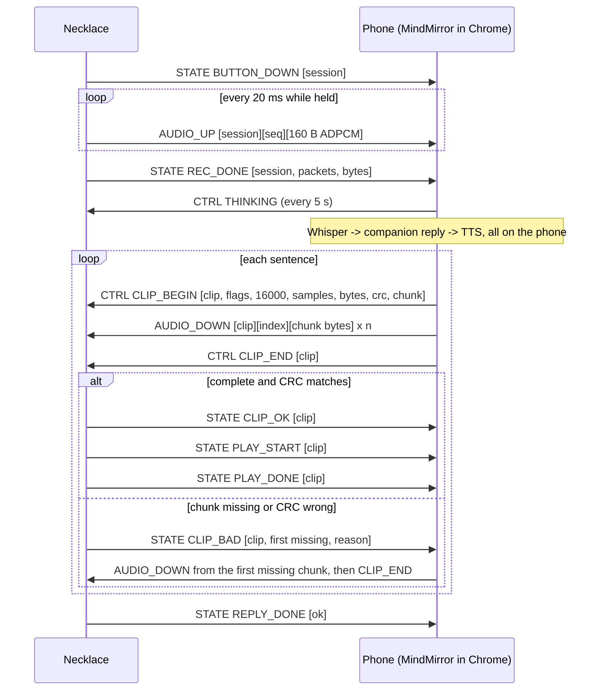

# MindMirror Necklace BLE protocol, version 2

This is the single source of truth for the link between the necklace firmware and the app.
`firmware/mindmirror_necklace/protocol.h` and `src/lib/necklace/protocol.ts` mirror it exactly.
If you change a value, change it in all three places.

## Roles and identity

- The necklace is a BLE peripheral and GATT server. It advertises as `MindMirror-XXXX`, where XXXX comes from the chip's MAC address, and it advertises the service UUID below.
- The phone is the central. It runs the MindMirror web app in Chrome on Android and pairs through the Web Bluetooth chooser. No PIN or bonding is used. The link is the plain BLE link, and the app is the only client.
- One phone at a time. After a disconnect the necklace advertises again at once.

## GATT

| Name | UUID | Properties | Payload |
|---|---|---|---|
| Service | `6e400001-b5a3-f393-e0a9-e50e24dc4d4d` | | |
| AUDIO_UP | `6e400002-b5a3-f393-e0a9-e50e24dc4d4d` | notify | `[session u8][seq u16][ADPCM bytes]` |
| CTRL | `6e400003-b5a3-f393-e0a9-e50e24dc4d4d` | write, write without response | `[op u8][args]` |
| STATE | `6e400004-b5a3-f393-e0a9-e50e24dc4d4d` | notify, read | `[event u8][args]` |
| AUDIO_DOWN | `6e400005-b5a3-f393-e0a9-e50e24dc4d4d` | write without response (max 512) | `[clip u8][index u16][ADPCM bytes]` |

All multi-byte numbers are little-endian.

The app writes CTRL with response (ordered and acknowledged) and AUDIO_DOWN without response (fast). Chrome allows one GATT operation at a time, so the app queues every write.

## MTU

On connect, the necklace requests 2M PHY, 251-byte data length, a 7.5 to 15 ms connection interval, and it starts an ATT MTU exchange itself (preferred MTU 517). It reports the result in HELLO, and again whenever the MTU changes.

- Uplink packets carry up to `min(MTU - 6, 160)` ADPCM bytes. At MTU 166 or more, one 20 ms frame fits in one notification.
- Downlink chunk size is `min(MTU - 6, 241)` bytes. The app computes it from HELLO and sends it in CLIP_BEGIN.

## Audio format (both directions)

| | Value |
|---|---|
| Sample rate | 16,000 Hz |
| Channels | mono |
| Encoding | IMA ADPCM, 4 bits per sample, low nibble first |
| Codec state | starts at predictor 0, index 0 for every recording and every clip |
| Frame | 20 ms = 320 samples = 160 bytes |
| Bit rate | 64 kbit/s (8 KB/s) |
| Max recording | 30 s (the necklace stops on its own) |
| Max reply clip | 240,000 bytes = 30 s. Replies are split into one clip per sentence. |
| Integrity | CRC-32 (IEEE, as in zlib) over the clip's ADPCM bytes |

## App to necklace: CTRL ops

| Op | Name | Args | Effect |
|---|---|---|---|
| 0x01 | HELLO | | necklace answers EV_HELLO |
| 0x02 | THINKING | | keep-alive while the phone works; LED shimmers yellow |
| 0x03 | IDLE | | stop waiting; LED idle |
| 0x04 | CALM | cycles u8 | breathing light, 4 s in, 6 s out |
| 0x05 | VOLUME | 0..100 u8 | saved in flash |
| 0x06 | PLAY_LOCAL | clip u8 | play a phrase stored in the necklace (see below) |
| 0x07 | STOP | | stop playback, drop queued clips |
| 0x08 | ERROR | | red flash |
| 0x20 | CLIP_BEGIN | clip u8, flags u8, rate u16, samples u32, bytes u32, crc32 u32, chunk u16 | start receiving a clip (19 bytes total). Flags bit 0 means the last clip of this reply. |
| 0x21 | CLIP_END | clip u8 | necklace checks and answers EV_CLIP_OK or EV_CLIP_BAD |
| 0x22 | CLIP_ABORT | clip u8 | forget a clip |

Stored phrases for PLAY_LOCAL: 0 hello, 1 "I can't reach your phone", 2 "Sorry, I didn't catch that", 3 speaker test, 4 low battery, 5 "I've put my answer on your phone screen". They are recorded voice lines, never AI replies, and the LED turns amber while a fallback line plays.

## Necklace to app: STATE events

| Event | Name | Args |
|---|---|---|
| 0x10 | BUTTON_DOWN | session u8 |
| 0x11 | REC_DONE | session u8, packets u16, bytes u32, reason u8 (0 released, 1 time limit) |
| 0x20 | BATTERY | pct u8, mV u16 |
| 0x30 | HELLO | protocol u8 (=2), mtu u16, features u8, volume u8, fw major u8, fw minor u8 |
| 0x31 | CLIP_OK | clip u8 |
| 0x32 | CLIP_BAD | clip u8, first missing chunk u16, reason u8 (1 missing, 2 CRC, 3 unknown clip) |
| 0x33 | PLAY_START | clip u8 (0xF0 + n for stored phrase n) |
| 0x34 | PLAY_DONE | clip u8, interrupted u8 |
| 0x35 | REPLY_DONE | ok u8 |
| 0x40 | ERROR | code u8, detail u8 |

Feature bits in HELLO: 0x01 speaker, 0x02 battery sense, 0x04 stored phrases.

Error codes: 1 no PSRAM, 2 mic init, 3 amp init, 4 bad clip format, 5 queue full, 6 clip timeout, 7 low battery, 8 phone silent.

## One conversation turn

## Example bytes

- Phone asks who is there: CTRL `01`. Necklace answers STATE `30 02 05 02 05 46 02 00`, meaning protocol 2, MTU 517, speaker and stored phrases, volume 70, firmware 2.0.
- First uplink packet of session 3: AUDIO_UP `03 00 00` followed by 160 ADPCM bytes.
- Recording ended after 2 s: STATE `11 03 64 00 80 3e 00 00 00`, meaning session 3, 100 packets, 16,000 bytes, button released.
- Reply sentence of 2.5 s (40,000 samples, 20,000 bytes), last clip, chunk 241: CTRL `20 07 01 80 3e 40 9c 00 00 20 4e 00 00 <crc32 4 bytes> f1 00`.
- Chunk 12 of clip 7: AUDIO_DOWN `07 0c 00` followed by 241 bytes.
- Necklace missing chunk 12: STATE `32 07 0c 00 01`.

## Timeouts and recovery

| Situation | Rule |
|---|---|
| CLIP_BEGIN to CLIP_END | 10 s, or the necklace drops the half clip |
| App waiting for CLIP_OK after CLIP_END | 4 s, then resend the whole clip |
| Retries per clip | 2, then CLIP_ABORT and the app asks for stored phrase 5 |
| Between clips of one reply | 15 s, then REPLY_DONE ok=0 |
| After REC_DONE with no THINKING or clip | 30 s, then the necklace plays stored phrase 1 |
| Button pressed while speaking | playback stops, queue cleared, PLAY_DONE interrupted=1, REPLY_DONE ok=0, new recording starts |
| Button pressed while not connected | necklace plays stored phrase 1 |
| Disconnect | necklace drops half-received clips (finished, verified clips may still play) and advertises; the app retries `gatt.connect()` after 1, 2, 4, 8 and 8 s |
| Uplink gap (missing seq) or under 90% of packets | the app does not transcribe it and asks for stored phrase 2 |

The necklace never plays a clip that is incomplete or fails its CRC.
